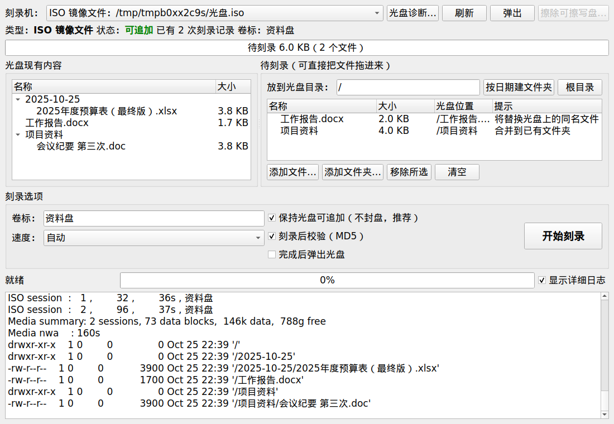
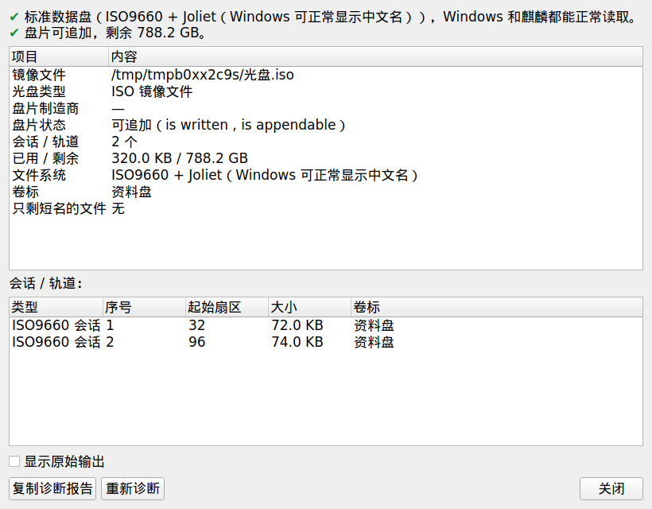
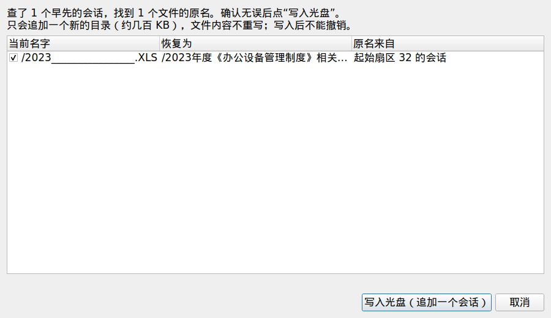
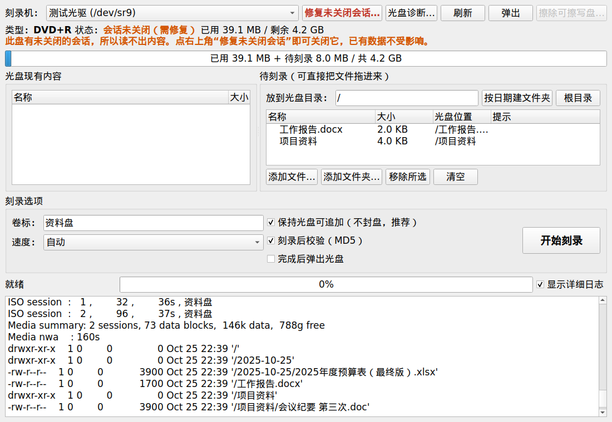
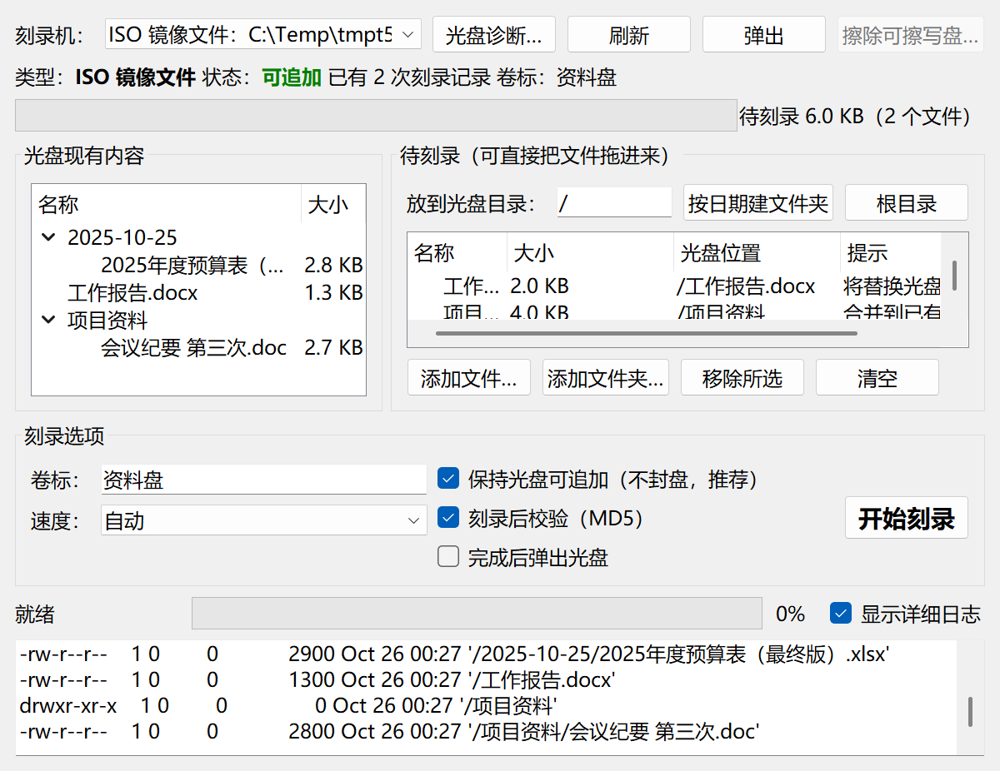

<div align="center">


# 光盘刻录助手

**专为银河麒麟 V10 打造的数据光盘刻录工具**

刻出来的盘 Windows 上中文名不乱码 · 默认不封盘，可以反复追加 · 离线一条命令装好

[](https://github.com/tcpqueue/kylin-disc-burner/releases/latest)
[](LICENSE)
[](#兼容性)
[](docs/windows.md)
[](#下载)
[](https://www.gnu.org/software/xorriso/)

[下载](#下载) · [快速开始](#快速开始) · [功能](#功能一览) · [文档](#文档) · [常见问题](docs/faq.md)



</div>

---

## 为什么要做这个

麒麟系统自带的刻录软件在日常办公中有两个很让人头疼的问题：

| 问题 | 现象 | 原因 |
|---|---|---|
| **文件名乱码** | 拿到 Windows 上，`工作报告.docx` 变成 `____.DOCX` | 只写了 Rock Ridge，没写 Windows 能识别的 Joliet 目录 |
| **一次就封盘** | 刻完一次，光盘再也不能追加，剩下的空间全浪费 | 默认使用 `-close on`，直接关闭了整张盘 |

光盘刻录助手用成熟的 [GNU xorriso](https://www.gnu.org/software/xorriso/) 作为刻录引擎，把这两件事都做对：

<table>
<tr>
<th width="50%">麒麟自带刻录</th>
<th width="50%">光盘刻录助手</th>
</tr>
<tr>
<td>

```text
D:\
├── ____.DOCX
├── 2025__________.XLSX
└── ____\
    └── ________.DOC
```

</td>
<td>

```text
D:\
├── 工作报告.docx
├── 2025年度预算表（最终版）.xlsx
└── 项目资料\
    └── 会议纪要 第三次.doc
```

</td>
</tr>
<tr>
<td>❌ 刻一次就封盘</td>
<td>✅ 默认不封盘，同一张盘可以追加几十次</td>
</tr>
</table>

## 功能一览

<table>
<tr>
<td width="33%" valign="top">

### 🔤 中文名不乱码
始终同时写入 Joliet 和 Rock Ridge 目录，并启用长文件名，单个名字最长 103 个字符。Windows 和麒麟上看到的都是原来的名字。

</td>
<td width="33%" valign="top">

### ➕ 多次追加
默认只关闭本次会话，不封盘。每次追加的新会话都包含之前所有文件，可以按日期建文件夹归档。

</td>
<td width="33%" valign="top">

### ✅ 刻完自动校验
刻录后逐个文件读回，比对 MD5。支持单个超过 4 GB 的文件。

</td>
</tr>
<tr>
<td valign="top">

### 🩺 光盘诊断
显示盘片类型、开闭状态、每个会话和轨道、文件系统（ISO9660 / Joliet / UDF）、内核 UDF 支持情况，给出结论和建议。

</td>
<td valign="top">

### 🔁 恢复长文件名
已经变成 `2023__~1.XLS` 的盘，可以从早先的会话里找回原来的中文名，只追加几百 KB 的目录，文件内容不重写。

</td>
<td valign="top">

### 📦 离线一次装好
自带 xorriso 1.5.8 和 Python / PyQt5 运行环境，不依赖任何系统软件包。内网机器 `dpkg -i` 一条命令装好。

</td>
</tr>
</table>

此外还有：一键挂载 UDF 光盘、检测并关闭 Windows 遗留的未关闭会话、生成 ISO 镜像文件、擦除可擦写光盘、写入卡住提醒等。

<details>
<summary><b>更多截图</b></summary>
<br>

| 光盘诊断 | 恢复长文件名 |
|:---:|:---:|
|  |  |

| 发现未关闭的会话 |
|:---:|
|  |

</details>

## 下载

到 [Releases](https://github.com/tcpqueue/kylin-disc-burner/releases/latest) 页面下载与 CPU 对应的安装包：

| 机器 | CPU | 安装包 |
|---|---|---|
| 国产 ARM 终端 | 飞腾 D2000 / D3000 / FT-2000/4、鲲鹏等 | `discburner_<版本>_arm64.deb` |
| x86 终端 | 兆芯、海光、Intel、AMD | `discburner_<版本>_amd64.deb` |
| Windows 7 SP1 / 8.1 / 10 / 11 电脑 | 64 位 | [`discburner-<版本>-portable.exe`](https://github.com/tcpqueue/kylin-disc-burner/releases?q=windows)（单文件版，双击即用）<br>或 `discburner-<版本>-windows-x64.zip`（绿色版，解压即用） |

不确定是哪种？在终端运行 `dpkg --print-architecture`，输出 `arm64` 或 `amd64`。

### Windows 版

办公室里麒麟和 Windows 电脑往往混着用，同一张光盘在两边来回追加。Windows 自带的刻录往麒麟刻的盘里追加时会把文件名写成 `2023__~1.XLS` 这样的短名，Windows 版就是为这种情况准备的：刻出来的盘在两边都显示完整的中文名，可以和麒麟版交替追加。详见 [Windows 版说明](docs/windows.md)。

<p align="center"></p>

## 快速开始

```bash
# 1. 安装（不需要联网）
sudo dpkg -i discburner_1.5.1_arm64.deb

# 2. 自检（不用光驱，几秒钟），看到“自检通过”即可
discburner --selftest ~/自检.iso
```

装好后在**开始菜单**里找“光盘刻录助手”，或在终端运行 `discburner`。

刻录只需四步：**选刻录机 → 把文件拖进右侧列表 → 填卷标 → 开始刻录**。默认保持光盘可追加并在刻录后校验，不需要改任何设置。

> [!TIP]
> 生成的 `自检.iso` 可以拷到 Windows 上双击打开，亲眼核对一下中文文件名。

> [!NOTE]
> 如果麒麟“安全中心 → 应用控制与保护”开启了执行控制，未签名的程序可能会被拦截，请让管理员放行。

## 兼容性

| 系统 | x86_64 | arm64 |
|---|:---:|:---:|
| 银河麒麟 V10 2020 版（Ubuntu 16.04 基础） | ✅ 已测试 | ✅ 等效环境测试 |
| 银河麒麟 V10 SP1 2503（Ubuntu 20.04 基础） | ✅ 已测试 | ✅ 等效环境测试 |
| 其他 glibc ≥ 2.23 的 Debian / Ubuntu 系发行版 | 应可使用 | 应可使用 |

- x86_64 两行使用麒麟官方镜像提取的完整系统测试；arm64 在 x86 上用 qemu 模拟同版本基础系统测试，**尚未在飞腾真机上验证**。
- 系统有可用的 Python 3 + PyQt5 时用系统的（界面跟随麒麟主题），没有就自动改用自带的，详见[安装指南](docs/install.md#运行时用哪套环境)。

| 光盘 | 多次追加 |
|---|---|
| CD-R、DVD+R、DVD-R、DVD+R DL、BD-R | ✅ 可以 |
| CD-RW、DVD+RW、DVD-RW、BD-RE、DVD-RAM | ✅ 可以，还能整盘擦除重写 |

## 文档

| 文档 | 内容 |
|---|---|
| [安装指南](docs/install.md) | 选包、离线安装、自检、运行环境选择、升级与卸载 |
| [使用指南](docs/usage.md) | 刻录与追加、卷标、速度、校验、ISO 镜像、可擦写盘 |
| [光盘诊断与修复](docs/diagnose.md) | 诊断报告、挂载 UDF 光盘、恢复长文件名、未关闭会话 |
| [技术原理](docs/principles.md) | 乱码与封盘的根因分析、Joliet、多会话、xorriso 版本问题、UDF 支持 |
| [开发与构建](docs/development.md) | 代码结构、测试、从源码构建离线安装包 |
| [常见问题](docs/faq.md) | 与 Windows 混用、光盘选择、故障排查 |
| [Windows 版说明](docs/windows.md) | Windows 绿色版的用法、与麒麟版的区别、构建方法 |
| [更新日志](CHANGELOG.md) | 版本历史 |

## 验证情况

我们尽量把“测过什么、没测过什么”写清楚：

| 项目 | 状态 |
|---|---|
| 中文长文件名、多次追加、MD5 校验 | ✅ 自动化测试 + 真实 DVD+R 实测 |
| 恢复长文件名 | ✅ 真实光盘实测，Windows 资源管理器核对 |
| 光盘诊断、UDF 挂载 | ✅ 镜像与块设备测试，真实光驱读取 |
| 离线安装、卸载无残留 | ✅ 麒麟 2020 / SP1 / arm64 环境各自测试 |
| 检测未关闭会话 | ✅ 基于真实光驱输出 |
| 关闭未关闭会话（修复） | ⚠️ 尚未在真实的未关闭光盘上验证 |
| 飞腾真机 | ⚠️ 尚未验证 |
| Windows 版：真实光驱读取、追加刻录、MD5 校验、资源管理器核对 | ✅ Windows 11 + USB 刻录机实测 |
| Windows 版：Windows 7 | ⚠️ 已按 Win7 兼容方式构建，导入表检查通过，尚未在 Win7 真机上运行 |
| Windows 版：普通用户（非管理员）账户 | ⚠️ 尚未验证 |

首次在新机器上使用，建议先用一张可擦写盘或便宜的 DVD+R 试刻。遇到问题欢迎[提交 Issue](https://github.com/tcpqueue/kylin-disc-burner/issues)，附上“光盘诊断 → 复制诊断报告”的内容会很有帮助。

## 致谢

- [GNU xorriso](https://www.gnu.org/software/xorriso/) / [libburnia](https://github.com/libburnia) —— 刻录与 ISO 9660 引擎
- [PyQt5](https://www.riverbankcomputing.com/software/pyqt/) / [Qt](https://www.qt.io/) —— 图形界面
- [PyInstaller](https://pyinstaller.org/) —— 打包自带运行环境

## 许可证

本项目以 [GPL-3.0](LICENSE) 许可证发布。安装包内自带的 xorriso（GPLv3+）、PyQt5（GPLv3）、Qt（LGPLv3）等组件遵循各自的许可证，xorriso 完整源码随安装包一起提供（`/usr/share/doc/discburner/`）。
