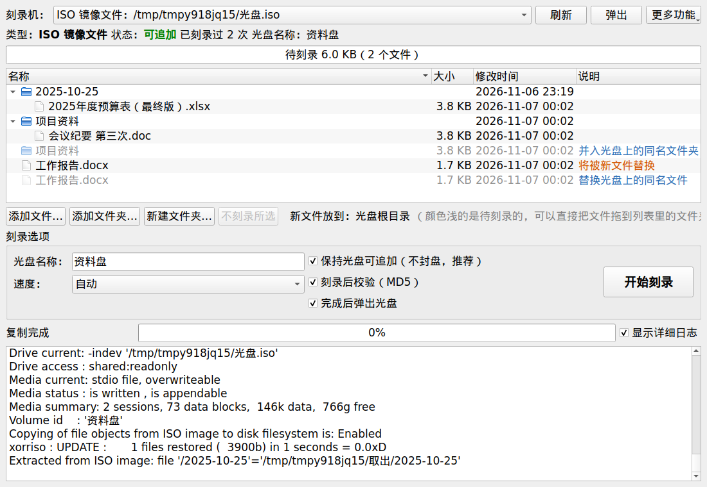

# 使用指南

[← 返回首页](../README.md)

- [界面概览](#界面概览)
- [第一次刻录](#第一次刻录)
- [往已有光盘追加](#往已有光盘追加)
- [从光盘复制文件出来](#从光盘复制文件出来)
- [从光盘删除文件（隐藏）](#从光盘删除文件隐藏)
- [往 UDF 盘追加](#往-udf-盘追加)
- [刻录选项](#刻录选项)
- [生成 ISO 镜像文件](#生成-iso-镜像文件)
- [可擦写光盘](#可擦写光盘)
- [刻录中出现问题](#刻录中出现问题)
- [光盘类型怎么选](#光盘类型怎么选)
- [日志](#日志)

## 界面概览



| 区域 | 作用 |
|---|---|
| 顶部：刻录机 | 选择光驱；右边依次是“光盘诊断”“刷新”“弹出”“擦除可擦写盘” |
| 状态行 | 光盘类型、状态（空白盘 / 可追加 / 已封盘 / 会话未关闭）、已有几次刻录记录、卷标 |
| 容量条 | 已用 + 待刻录 / 总容量，超出时变红 |
| 左侧：光盘现有内容 | 光盘上已经有的文件和文件夹，可以拖出去或右键“复制到…” |
| 右侧：待刻录 | 这次要写入的文件，可以直接从文件管理器拖进来 |
| 底部：刻录选项 | 卷标、速度、是否保持可追加、是否校验、完成后是否弹出 |

## 第一次刻录

1. 放入空白光盘，在“刻录机”里选择光驱。状态行显示“空白盘”和可用容量。
2. 把要刻的文件或文件夹**拖进右侧列表**，或者点“添加文件…”“添加文件夹…”。
3. 确认卷标。空白盘会自动填上“光盘 + 今天的日期”，可以改成自己的名字。
4. 点“**开始刻录**”，确认对话框里会列出项目数、总大小、目标光驱、卷标和刻录后是否封盘。

刻录完成后会自动读回校验，提示“刻录完成，校验通过”，左侧列表随即刷新为光盘上的内容。

## 往已有光盘追加

放入以前刻过、还没封盘的光盘，状态行显示“**可追加**”和“已有 N 次刻录记录”。之后的操作和第一次刻录完全一样。

**放到光盘目录**

右侧“放到光盘目录”决定这次的文件放在光盘的哪个文件夹里：

- 默认 `/`，即光盘根目录；
- 点“**按日期建文件夹**”会填入今天的日期，例如 `/2025-10-25`，每次追加各放一个日期目录，便于归档；
- 也可以手动输入任意路径，例如 `/财务/2025`，不存在的文件夹会自动创建。

**同名文件**

“提示”一栏会标出：

- **将替换光盘上的同名文件**：光盘上已经有同路径的文件。新文件会顶替旧文件，旧文件看不到了，但在一次性光盘上它**仍然占用空间**。
- **合并到已有文件夹**：文件夹已存在，里面的内容会合并。

> [!NOTE]
> 每个新会话都包含光盘上全部旧文件的目录，所以 Windows（只读最后一个会话）也能看到所有文件。

> [!TIP]
> 在麒麟上追加完成后，如果文件管理器里还是旧内容，弹出再放入即可（系统缓存了旧目录）。“完成后弹出光盘”默认勾选，就是为了避免这种情况。

## 从光盘复制文件出来

左侧“光盘现有内容”里的文件和文件夹可以直接复制出来：

- **拖出去**：选中（按住 Ctrl 或 Shift 可以多选），拖到文件管理器的窗口或桌面上，相当于复制。
- **右键“复制到…”**：选一个文件夹，把选中的项目复制进去，完成后自动打开那个文件夹。东西多、文件大时用这个更合适，复制过程中界面不会卡住。

说明：

- 光盘被系统挂载着时，拖出的就是挂载目录里的文件，由文件管理器负责复制；没挂载时程序会先挂载。
- ISO 镜像文件或挂载不了的光盘，拖出前要先把文件读到临时目录，文件大时要等一会儿。
- 复制出来的文件会去掉只读属性，可以直接修改。
- 正在刻录时不能复制。

## 从光盘删除文件（隐藏）

左边选中文件或文件夹，右键“**从光盘删除（隐藏）…**”。

一次性光盘写过的地方不能改，所以这里的“删除”和 Windows 在 DVD+R 上删除 UDF 文件一样，是追加一个不包含这些文件的新会话：

- 之后 Windows 和麒麟上都看不到它们；
- 空间**不会释放**，每删一次反而要多占几 MB（一个会话的开销），最好攒几个一起删；
- 早先的会话里还留着，必要时能找回；也因此**不能用来删除需要保密的文件**。

只有本软件能追加的 ISO9660 盘才能这样删除。

## 往 UDF 盘追加

1.8.2 起不再向含 UDF 的原盘追加 ISO9660。DVD+R 真盘测试中，新 ISO 会话内容与 MD5 均正确，但 Windows 重新放盘后仍可能挂载旧 UDF；混合会话也会出现同样的问题。因此不能把追加 ISO 会话当作可靠的原盘转换。

请使用以下流程：

1. 在“光盘诊断”中识别、挂载可读取的 UDF 部分；混合盘同时保留可读的 ISO 内容。
2. 点击“复制全部到本机…”，选择本机目录，核对文件数量与内容。
3. 取出原盘，换一张空白光盘，添加复制出的文件并开启 MD5 校验；这张新盘从第一会话起就是 ISO9660 + Joliet + Rock Ridge。

原盘不改写。可擦写盘也应先完整备份，再明确擦除后重刻。早先写过 UDF、最新会话又是 ISO 的盘，同样执行这一限制，防止 Windows 和本软件看到不同目录。

## 刻录选项

| 选项 | 默认 | 说明 |
|---|---|---|
| 卷标 | 自动 | 光盘的名字，Windows 的“此电脑”里显示。最多 16 个字符，并且不能超过 32 字节（约 10 个汉字） |
| 速度 | 自动 | “最低速”最稳妥，适合归档和外置 USB 光驱；“最高速”最快 |
| 保持光盘可追加（不封盘） | ✅ 勾选 | 只关闭本次会话，以后还能继续写。**取消勾选会封盘，之后不能再写入** |
| 刻录后校验（MD5） | ✅ 勾选 | 逐个文件读回比对 MD5，会多花一些时间 |
| 完成后弹出光盘 | ✅ 勾选 | 刻完自动弹出光盘；生成 ISO 镜像文件时不起作用 |

什么时候需要封盘？极少数老式光驱或播放器只认已封盘的光盘。普通电脑读取不封盘的光盘没有任何问题，所以一般不用封盘。

## 生成 ISO 镜像文件

“刻录机”下拉框的最后一项是“**生成 / 追加 ISO 镜像文件…**”。选择它可以不用光驱：

- 选一个新文件名 → 生成新的 ISO；
- 选一个已有的 ISO → 像光盘一样往里追加。

生成的 `.iso` 可以在 Windows 上双击打开查看，适合在正式刻录前先确认文件名效果，或者把镜像交给其他电脑去刻。

## 可擦写光盘

CD-RW、DVD±RW、BD-RE、DVD-RAM 可以：

- 和一次性光盘一样多次追加，而且次数不限；
- 点“**擦除可擦写盘…**”清空整张盘重新使用。擦除后数据无法恢复。

DVD-RW 第一次擦除时会被格式化为“可覆盖”模式，之后的追加效率更高。

## 刻录中出现问题

**写入卡住**

如果进度超过 90 秒没有变化，状态行会变红，提示检查光驱的连接和供电。外置 USB 光驱最常见的原因是供电不足，可以换带供电的 USB 口，或者给光驱接独立电源，并选择“最低速”重试。

**刻录失败**

程序会如实报告失败，并在日志里给出 xorriso 的原始输出。这时：

1. **先别急着弹出光盘或断电**；
2. 点“光盘诊断…”看看光盘现在的状态；
3. 一次性光盘写失败时，如果数据还没开始落盘，光盘通常没有任何变化，换个速度重试即可。

**刻录中关闭窗口**

正在写入时窗口关不掉，程序会提示等待完成。不要用强制结束进程、拔线或断电的方式中断，否则这张盘最后一个会话可能损坏。

## 光盘类型怎么选

| 光盘 | 能否追加 | 建议 |
|---|---|---|
| DVD+R | ✅ | **日常归档首选**，兼容性好，多次追加开销小 |
| DVD-R | ✅ | 也可以用 |
| CD-R | ✅ | 每次追加约有 7～14 MB 的会话开销，追加次数多了空间损失明显 |
| DVD+R DL、BD-R | ✅ | 容量大，需要光驱支持 |
| 各种可擦写盘 | ✅ 次数不限 | 适合临时交换数据，长期保存不如一次性盘稳定 |

> [!WARNING]
> 用 Windows UDF 方式刻过的盘，应先复制文件，再换空白盘刻录，见[往 UDF 盘追加](#往-udf-盘追加)。

## 日志

每次刻录、诊断的详细日志保存在：

```
~/.local/share/discburner/logs/
```

勾选窗口右下角的“显示详细日志”可以实时查看 xorriso 的输出。反馈问题时附上对应的日志会很有帮助。

## 文件名长度

为使 Windows 和麒麟保留一致的文件名，每一级文件名或目录名最多 103 个 UTF-16 单元，扩展名也计入。普通汉字和英文字母通常各占 1 个，`𠮷`、emoji 等占 2 个。整条路径不按这个上限计算。

只有超过上限的名称才自动截短，扩展名保留并计入总长度。截短后若与其他名称重名，则加上 ` (2)`、` (3)` 等编号，并进一步缩短主文件名，保证总长度不超过 103。目录名超过上限时也会截短。

刻录前显示原路径与光盘上新路径的对照，确认后写入；可以取消。本机源文件始终不改名。追加时会同时处理盘上已有的超长名称，UDF 文件迁移也使用相同规则。扩展名本身过长、无法完整保留时停止刻录并提示。
